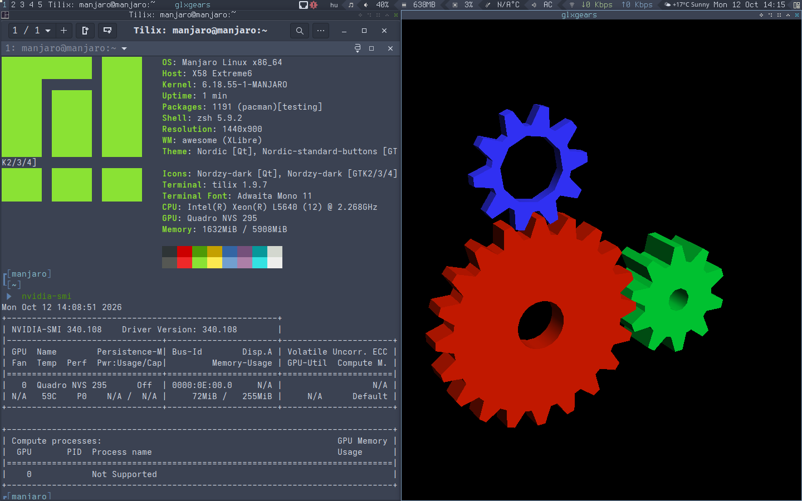
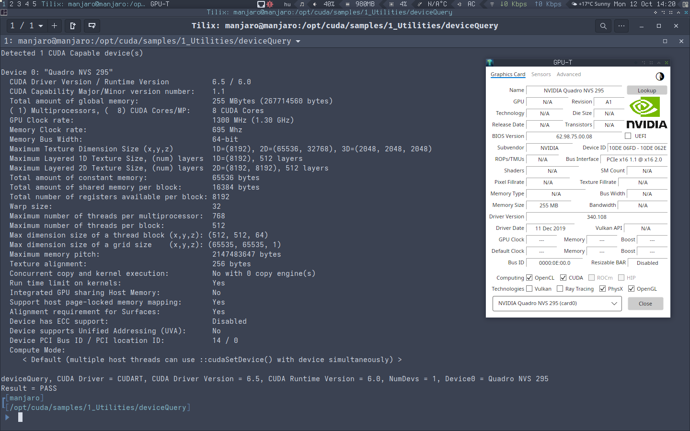

# nvidia-340xx-utils

Manjaro/Arch packaging for the NVIDIA 340.108 legacy driver, built on top
of the Debian `340xx/main` patch workflow.

It is an independent Manjaro-oriented PKGBUILD that reuses the Debian
patchset and applies a small set of follow-up patches to extend kernel
module build support to recent Linux kernels (up to 7.3 at the time of
writing).

The packaging structure (PKGBUILD, `.install`, `.rules`, `mhwd-nvidia`,
etc.) is derived from the Manjaro `nvidia-390xx-utils` package.

## Status

The kernel module builds cleanly on the kernels listed below.

| Kernel   | Result |
|----------|--------|
| 6.1      | OK     |
| 6.1-rt   | OK     |
| 6.6      | OK     |
| 6.6-rt   | OK     |
| 6.12     | OK     |
| 6.12-rt  | OK     |
| 6.18     | OK     |
| 7.1      | OK     |
| 7.2      | OK     |
| 7.3      | OK     |

## ⚠️ Display server requirement

The 340.108 driver requires the **legacy ABI** X server:

- **XLibre**: `xlibre-xserver-legacyabi` — **required**.
  The normal `xlibre-xserver` does **not** work with 340.108.
  If you boot a modern XLibre session with the 340 driver, the kernel
  module still loads and `nvidia-smi` still works, but **OpenGL
  silently falls back to Mesa llvmpipe** (software rendering).
  Check with `glxinfo | grep -i renderer`.
- **Xorg**: `xorg-xserver` — **untested**.
  The whole ABI split only exists in XLibre. Plain Xorg has no such
  split, so in theory the 340.108 driver should load and work with
  `xorg-xserver` without any additional handling. We have never tested
  this. If you try it, please report back.

Wayland is **not supported**. The 340.108 driver has no atomic
modesetting and no modern Wayland/EGLStreams support.

## Patch workflow

Patches are listed in `series.resolved` and applied in that order from
the `kernel/` directory using `patch -Np1`. The PKGBUILD `prepare()`
function iterates over the list and applies each patch in sequence.

The Debian-named patches keep their original names. The follow-up
patches use descriptive names without numeric prefixes:

| Patch | Purpose |
|---|---|
| `kernel-6.18-workqueue-flush.patch` | `flush_workqueue(system_wq)` instead of the deprecated `flush_scheduled_work()` on 6.18+ |
| `kernel-6.18-prime-fence-flush.patch` | direct `flush_scheduled_work()` in `nvidia-drm-prime-fence.c` (also 6.18+) |
| `kernel-7.0-screen_info.patch` | `sysfb_primary_display.screen` when `screen_info` was removed (6.20+) |
| `vma-lock-7.0-plus.patch` | `__is_vma_write_locked()` signature change, `VMA_LOCK_OFFSET` → `VM_REFCNT_EXCLUDE_READERS_FLAG` |
| `kernel-7.2.patch` | `drm_atomic_state` → `drm_atomic_commit` rename, `strncpy` → `strscpy` |
| `kernel-7.3-acpi.patch` | stub `nv_acpi_init()` / `nv_acpi_uninit()` on 7.3+ (`struct acpi_driver` was removed, its `platform_driver` replacement is GPL-only) |
| `fixup-warnings.patch` | silence `-Wunused-result` on `refcount_sub_and_test()` |
| `make-modesetting-default.patch` | enable `nvidia-drm` modeset by default (required by 6.12+) |

## Security backports

The following source-level fixes from the 390.157 branch have been
ported to 340.108:

| Patch | CVE |
|---|---|
| `cve-2022-34670-nv-h-IS-OFFSET.patch` | CVE-2022-34670, CVE-2022-34677, CVE-2022-34680, CVE-2022-42257, CVE-2022-42258, CVE-2022-42259 — integer overflow / truncation in `IS_*_OFFSET` bounds checks |
| `cve-2022-34674-vma-size.patch` | CVE-2022-34674 — VMA size validation |
| `cve-2022-34670-nv-c-usage-count-overflow.patch` | hardening — `usage_count` overflow in `nvidia_open()` |

Additional CVE backports are **work in progress**: harvesting
source-level security fixes from the 470 branch, porting them down to
390, then to 340.

## Hardware tested

- **NVS 295** — driver 340.108 loads, hardware OpenGL via `glxgears`,
  `Enemy Territory (ETLEGACY)` playable, CUDA samples (`cuda60`,
  `cuda65`) run correctly.
- **GeForce 210 (GT218)** — `nvidia-settings` starts and reports driver
  340.108, `nvidia-smi` reports the GPU correctly, hardware OpenGL
  confirmed.

## Live ISO

A Manjaro live ISO with this driver is available:

- **Awesome WM (340-only, legacy ABI XLibre)**:
  https://sourceforge.net/projects/manjaro-awesome-iso/files/Releases/testing-legacy340nvidia-stack/
- **Xfce + Compiz (340-only, legacy ABI XLibre)** — *not yet available, coming soon*

The ISO ships kernel **6.18**.

## Credits

This package contains traces of, summarises, and draws inspiration
from the work of many people.

**Andreas Beckmann** ([@anbe42](https://salsa.debian.org/anbe42)) –
Debian 340xx maintainer. The Debian patchset and the entire patch
workflow this repository is built on are his work.

**Joan Bruguera Micó** ([@joanbm](https://github.com/joanbm)) – his
470xx patchset is the origin of several patches in this repository,
which were ported down to 390 and then to 340.

**Oleh Nykyforchyn** ([@ONykyf](https://github.com/ONykyf)) –
Slackware build scripts, source of several VMA-lock ideas.

**Mark Wagie** ([@yochananmarqos](https://github.com/yochananmarqos)) –
guidance and patience throughout the project.

**Philip Müller** ([@hphilm](https://github.com/hphilm)) and the
**Manjaro team** – thanks for their work and for maintaining the
`nvidia-390xx-utils` package, whose PKGBUILD structure this repository
is based on. The `kernel-7.3-acpi.patch` was carried over to the
390xx branch from this work.

Thank you all.

## Notes

**CVE fixes**: only the open-source parts are being worked on. The
kernel module security patches listed above are what we have so far.
Additional backports are work in progress.

## Disclaimer

This is an unofficial, community-maintained package. It is **not
endorsed by NVIDIA, Debian, or Manjaro**. It is provided as-is, without
warranty of any kind, express or implied. **The author is not
responsible for any damage, data loss, hardware failure, or any other
consequence arising from the use of this package.**

The 340xx driver series is in **legacy/EOL status**. It contains known
**security vulnerabilities** that will not be fixed upstream. Use it
only on systems that are not exposed to untrusted input, and only if
you understand the risks.

The package is intended for use with **Xorg** based servers only:
`xlibre-xserver-legacyabi` (tested) or `xorg-xserver` (untested).
Wayland and other display servers are not supported.

Use at your own risk.